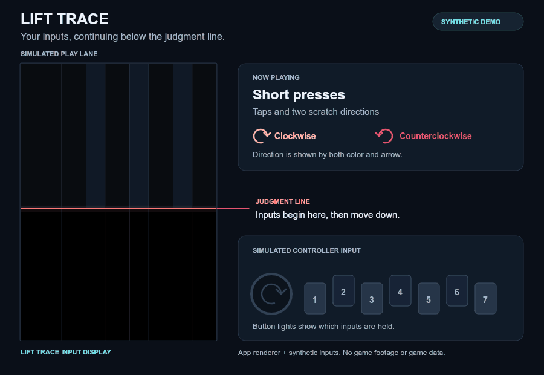

# Lift Trace

[한국어](README.md) · [日本語](README.ja.md) · [English](README.en.md)

**An OBS input overlay for beatmania IIDX INFINITAS.**

Lift Trace displays your key presses and scratch movements as input notes in the **LIFT area below the judgment line**. Match its position and speed to the game to show your inputs continuing downward after the game notes reach the judgment line.

**[Download for Windows](https://github.com/d0vetam3r/lift-trace/releases/latest)** · [Step-by-step guide](docs/USER_GUIDE.en.md)

*Illustrative demo: the incoming notes above the judgment line are simulated; the input notes below are drawn by Lift Trace. This is not a game recording.*

## Get started

You need Windows 10/11 (64-bit), OBS Studio, INFINITAS and a compatible controller. **No Python installation or commands are needed.**

1. Open the [latest release](https://github.com/d0vetam3r/lift-trace/releases/latest) and expand **Assets**. Download the file starting with `lift-trace-windows-x64-` and ending in `.zip`.
2. Right-click the ZIP → **Extract All**. Open the extracted **LiftTrace** folder and double-click **LiftTrace.exe**.
3. Enter the green number, LIFT and SUDDEN+ values you use in the game. Set **Input source** to **Controller · works while playing**, select your device, then follow **Controller setup**. Select **1P** for a turntable on the left or **2P** for one on the right.
4. Follow the [OBS setup steps](docs/USER_GUIDE.en.md#4-paste-the-address-and-size-into-obs) to copy the overlay address, size and position into OBS.

Keep the extracted folder's files together. The guide assumes your game capture is already visible in OBS; it explains each remaining step with the buttons to click and what to check.

## What it shows

- **Keys and holds:** seven lanes show key presses; held inputs create longer notes.
- **Scratch direction:** clockwise ↻ uses light coral; counterclockwise ↺ uses deep coral. Reversals change both the arrow and color.
- **Height and speed:** green number, LIFT and SUDDEN+ calibrate falling speed. Height follows LIFT automatically or can be set manually; changing display height alone keeps the same speed.
- **OBS placement:** copy the address, dimensions and X/Y position. Optional OBS integration starts the overlay with OBS and stops the instance it started when OBS closes.

Input notes describe controller activity; the app does not read chart notes or game judgments. Calibration assumes a fullscreen game on a **1920 × 1080 OBS canvas**. The 2P position is a mirrored starting estimate, with adjustments available.

## Guides

| I want to… | Read |
| --- | --- |
| Set up the keys and turntable | [Controller setup](docs/USER_GUIDE.en.md#3-follow-the-key-and-scratch-setup-prompts) |
| Align the overlay with the game | [OBS placement](docs/USER_GUIDE.en.md#5-copy-the-numbers-to-place-the-overlay) |
| Change LIFT, height or 1P/2P | [Update size and position](docs/USER_GUIDE.en.md#after-changing-height-or-play-side) |
| Start the overlay with OBS | [Automatic startup](docs/USER_GUIDE.en.md#optional-start-it-with-obs) |
| Update or remove the app | [Update or remove](docs/USER_GUIDE.en.md#update-or-remove) |

## Help

Start with [troubleshooting](docs/USER_GUIDE.en.md#troubleshooting). If it does not solve the problem, [open an issue](https://github.com/d0vetam3r/lift-trace/issues) with the step you reached, the error message and your controller model. English, Korean and Japanese reports are welcome.

The Windows app is an **unsigned prototype**. See [validation status](docs/VALIDATION.en.md) for tested environments and checks still pending, and [security and local data](SECURITY.en.md) before sharing logs.

## Development and project information

The Windows app and source ZIP come from the same project. Clone this repository or download `lift-trace-source-*.zip` to contribute; the Windows ZIP above is the ready-to-run app.

[Development](docs/DEVELOPMENT.en.md) · [Contributing](CONTRIBUTING.en.md) · [Technical reference](docs/REFERENCE.en.md) · [Releasing](docs/RELEASING.en.md) · [Changelog](CHANGELOG.en.md)

Code and documentation were developed with extensive AI assistance. The validation record distinguishes automated checks from physical testing and human review.

Project code is [MIT licensed](LICENSE); bundled runtimes retain their own licenses. Lift Trace is an independent project and is not affiliated with or endorsed by KONAMI, DJ DAO/GAMO2 or the OBS Project.
