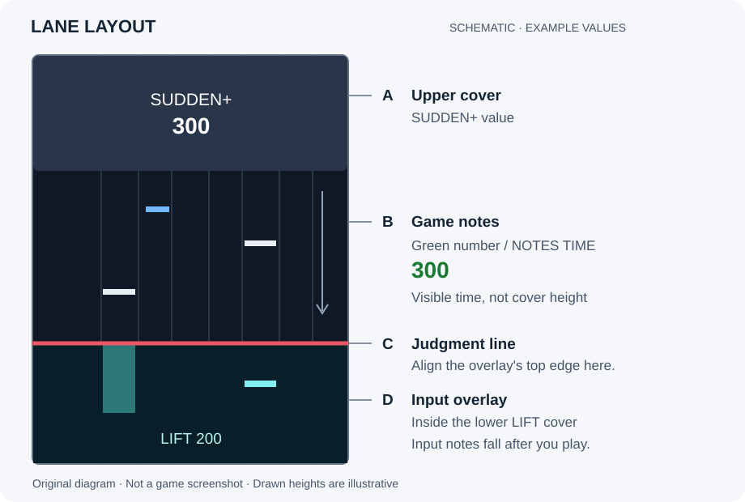

# 最初から順番に進める使い方

[한국어](USER_GUIDE.ko.md) · [日本語](USER_GUIDE.ja.md) · [English](USER_GUIDE.en.md) · [トップ](../README.ja.md)

**ダウンロード → 展開 → アプリを開く → ゲームの数値を入力 → 鍵盤・スクラッチの設定 → OBSに貼り付け** の順に進めます。コマンドの入力やPythonのインストールは不要です。

Windows 10/11（64ビット）のPCとコントローラーを用意してください。OBS StudioとINFINITASは別途必要です。以下のOBSの手順は、**OBSにゲーム画面がすでに映っている状態**で進めます。

## 1. ファイルをダウンロードして開く

1. プロジェクトのGitHubページで **Releases** を押します。通常は右側にあります。
2. 最新バージョンを開き、**Assets** を押します。ダウンロードできるファイルが表示されます。
3. 名前が `lift-trace-windows-x64-` で始まり、`.zip` で終わるファイルをダウンロードします。間の数字はバージョンなので、変わっていても大丈夫です。「Source code」や、名前に「source」があるファイルは選ばないでください。
4. ダウンロードしたファイルを右クリックし、**すべて展開** を選びます。保存先を選ぶ画面で **ドキュメント** などを選び、**展開** を押します。
5. 作成されたフォルダーを開き、その中の **LiftTrace** フォルダーで **LiftTrace.exe** をダブルクリックします。Windowsの設定によっては名前が **LiftTrace** とだけ表示されます。

**確認すること：** 小さな **Lift Traceウィンドウ** と、普段使うブラウザーの **設定画面** が開きます。設定画面が出なければ、小さなウィンドウの **設定を開く** を押してください。必要なら **日本語** を選びます。

展開したフォルダーは、ファイルを一緒に入れたまま保管してください。**LiftTrace.exeだけを移動しないでください。** 次回も同じファイルをダブルクリックします。

このガイドの **入力ノーツ** は、鍵盤を押したりスクラッチを回したりした操作を画面に表したものです。ゲームの譜面を読み取ったノーツではありません。

## 2. ゲームに表示される数値を入力する

ゲームのHI-SPEED設定画面を開き、**自分が使っている値** を次の欄に入力します。

| 入力する欄 | ゲームで確認する値 |
| --- | --- |
| **緑数字** | 緑色の **NOTES TIME** の数値 |
| **LIFT** | 下側のLIFTカバーの数値 |
| **SUDDEN+** | 上側のSUDDEN+カバーの数値。使わない場合は **0** |

カバーの数値が2か所にある場合は、上側のSUDDEN+と下側のLIFTを区別してください。HI-SPEEDの倍率やBPMは、この欄に入力しません。

図の **A** はSUDDEN+、**B** はゲームのノーツが見える部分、**C** は判定ライン、**D** は入力ノーツを置く下側のLIFT領域です。説明用の図であり、数値は例です。

**高さの設定** は **LIFT に自動で合わせる（推奨）** のままにします。例えばLIFTが **401** なら、表示の高さは **290** になります。例をそのまま使わず、自分のゲームのLIFTを入力してください。**速度補正** は最初は **1** にします。

**確認すること：** **オーバーレイの高さ** に計算された数値が表示されます。落ちる入力ノーツは、次の鍵盤設定を終えてから確認します。

**高さを自動で決める場合、LIFTが0だと判定ラインの下に表示する場所がないため、入力ノーツは見えません。** ゲームでLIFTを有効にし、その値を入力してください。別の高さを使う場合は、**高さの設定 → 手動で指定** を選び、使いたい高さを入力できます。

## 3. 案内に沿って鍵盤とスクラッチを設定する

1. INFINITASで普段使うモードにして、コントローラーをPCに接続します。
2. 設定画面の **入力ソース** で **コントローラー · プレイ中も入力を検出** を選びます。
3. すぐ下の **コントローラー** から自分の機器を選びます。一覧が空なら **検索** を押します。
4. **コントローラー設定** を押し、まずすべてのボタンから手を離します。
5. 案内に従い、**1鍵から7鍵まで** 左から右へ1つずつ押して離します。同時に複数を押さないでください。
6. **時計回り ↻** の案内が出たら、ターンテーブルを真上から見て **時計の針と同じ方向だけ** に回します。ほかのボタンには触れず、回した後に **時計回りを確認** を押します。
7. 次の **反時計回り ↺** の案内では、**時計の針と反対の方向だけ** に回し、**反時計回りを確認** を押します。
8. 結果が出たら **適用** を押します。やり直す場合は **最初から**、変更せずにやめる場合は **キャンセル** を押します。
9. スクラッチが左なら **1P**、右なら **2P** を選びます。

**確認すること：** 設定を終えると元の画面に戻ります。鍵盤を押すかスクラッチを回すと、プレビューの下側に入力ノーツが落ちます。上側のゲームノーツは説明用の例で、実際のゲーム画面ではありません。

回転方向の再設定を求められたら **回転方向を設定し直す** を押します。1鍵から7鍵の設定はそのままで、時計回りから両方向を確認し直します。設定中に接続を外した場合は、接続し直して最初から進めます。

スクラッチの表示も確認してください。

| 実際に回した方向 | 表示される入力ノーツ |
| --- | --- |
| 時計回り | **↻** と **淡いコーラル色** |
| 反時計回り | **↺** と **濃いコーラル色** |

交互に回すと、矢印と色が一緒に切り替わります。逆に見える場合は **コントローラー設定** をやり直し、案内された方向に回したか確認してください。同じ方向に回し続けると、1本につながって表示される場合があります。アプリは譜面を読み取らないため、連続した操作を譜面上の個々のスクラッチノーツに分けることはできません。

### 任意：入力ノーツの表示を変える

0.2.0では、**入力ノーツの表示 → 鍵盤ノーツの胴体を表示**で、つながる表示と頭だけの表示を切り替えられます。オンでは押した時間に応じてノートが伸びます。オフでは1–7鍵を押したときに生じた頭だけが落下し、長押ししても頭が繰り返し生成されることはありません。スクラッチの表示と実際の入力記録は変わりません。

胴体がオンの場合は、**短い入力を短く表示**で、離した後の短い入力だけを短くできます。**基準時間**未満の入力に**残す長さ**の割合を適用します。例えば200ms・70%なら、200ms未満の入力を元の長さの70%で表示します。70%削るという意味ではありません。基準以上の入力や、まだ押している入力は短くしません。

変更はまず比較用の例だけに反映されます。好みの表示になったら**適用して保存**を押すと実際のオーバーレイに反映されます。**変更を戻す**を押すと現在適用されている値に戻ります。胴体をオフにしても基準時間と割合は保持され、再びオンにするとそのまま使えます。

## 4. OBSにアドレスとサイズを貼り付ける

まずOBSの **設定 → 映像 → 基本（キャンバス）解像度** が **1920 × 1080** か確認してください。以下のサイズと位置の計算は、その画面全体をゲームが埋める構成が前提です。

以下では、Lift Traceの設定画面とOBSを交互に使います。入力する欄をクリックして、**Ctrlキーを押しながらA**を押すと、その欄の内容がすべて選択されます。続けて **Ctrlキーを押しながらV** を押すと、選択した内容がコピー済みの内容に置き換わります。以下では **Ctrl+A**、**Ctrl+V** と表記します。

1. 初めて設定するときは、Lift Traceの **オーバーレイ表示範囲** にある **1080p のレーンサイズに合わせる** を押します。全体の幅が **432** になり、各鍵盤とスクラッチの幅も合います。入力済みのゲームの値とコントローラー設定はそのままです。
2. **OBS に貼り付けるアドレスをコピー** を押します。
3. OBSの **ソース** 一覧の下にある **+** を押し、**ブラウザ** を選びます。名前を **Lift Input** にして **OK** を押します。
4. 開いた画面の **ローカルファイル** はチェックしません。**URL** 欄をクリックし、**Ctrl+A**、**Ctrl+V** の順に押します。元の内容が、コピーしたアドレスに置き換わります。
5. Lift Traceに戻り、**幅をコピー** を押します。OBSの **幅** 欄をクリックし、**Ctrl+A**、**Ctrl+V** を押します。
6. Lift Traceで **高さをコピー** を押します。OBSの **高さ** 欄をクリックし、**Ctrl+A**、**Ctrl+V** を押して **OK** を選びます。

**確認すること：** OBSのソース一覧に **Lift Input** が追加されます。最初は黒い四角に見える場合があります。鍵盤を押すと、その中に入力ノーツが表示されます。次の手順で、この四角の位置を合わせます。

アドレスの数字を覚えたり、自分で入力したりする必要はありません。幅と高さも、**今アプリに表示されている値** をそのまま使ってください。

より滑らかに表示するには、OBSで **Lift Input** をダブルクリックし、**カスタムフレームレートを使用** があれば有効にして **60 FPS** を入力します。その後 **OK** を押してください。

## 5. 数字をコピーして位置を合わせる

アプリの **横位置 (X)** は左右の位置、**縦位置 (Y)** は上下の位置です。**1P/2PとLIFTの値** から計算されるので、自分で計算する必要はありません。

1. OBSのソース一覧で **Lift Input** をゲームキャプチャーより上に移動します。横の鍵がかかっていたらクリックして外します。
2. **Lift Input** を右クリックし、**変換 → 変換をリセット** を選びます。以前の拡大・縮小や切り抜きを元に戻します。
3. もう一度右クリックし、**変換 → 変換の編集** を開きます。**位置揃え** は **左上**、**バウンディングボックスの種類** は **境界無し** にします。バージョンによっては境界無しが **自動** と表示されます。サイズ・回転・クロップの欄は変えません。
4. Lift Traceの **横位置をコピー** を押します。OBSの **位置** にある **X / X座標** の欄をクリックし、**Ctrl+A**、**Ctrl+V** を押します。
5. Lift Traceの **縦位置をコピー** を押します。OBSの **位置** にある **Y / Y座標** の欄へ同じように貼り付け、ウィンドウを閉じます。
6. OBSのプレビューで、四角の上端がゲームの判定ラインに、鍵盤ごとの縦の線がゲームのレーンに合うか確認します。合ったらソース一覧で **Lift Input横の鍵** をかけます。

**確認すること：** 判定ラインの下から自分の入力ノーツが落ちます。例えば1P・LIFT 401・位置調整0なら、Xは **75**、Yは **433**、高さは **290** です。この数字を覚えず、アプリのコピーボタンを使ってください。

2Pの位置は、1Pを左右対称にした計算上の開始位置です。2Pの実画面との一致はまだ確認していないため、画面を見ながら調整してください。

少しずれる場合は **OBS の位置を少し動かす** を開きます。**左右に移動** に **2** を入れると右へ、**-2** を入れると左へ2ピクセル移動できます。**上下に移動** に **2** を入れると下へ、**-2** を入れると上へ2ピクセル移動できます。ピクセルは画面上の距離の単位です。変更後の位置をコピーし、OBSの位置欄へもう一度貼り付けます。**1080p のレーンサイズに合わせる** を再度押すと、両方の移動量が0に戻ります。

幅だけが違う場合は **レーン全体の幅** を変え、**幅をコピー** でOBSのブラウザソースの **幅** を合わせます。幅を変えても、計算される開始位置は動きません。

四角の角を引っ張って伸ばしたり、**画面に合わせる** を選んだりしないでください。元のサイズ（100%）が変わるとゲームのレーンに合わなくなり、縦に伸びると落下速度も違って見えます。誤って変えた場合は、上の **変換をリセット** からやり直してください。位置が合っていても落下速度が違う場合は **速度補正**、入力ノーツが早く出すぎる場合は **表示遅延** を少しずつ調整します。

## 高さやプレイ位置を変えたときは

| 変えたもの | OBSに貼り付け直すもの |
| --- | --- |
| ゲームのLIFT | アプリにも新しいLIFTを入れ、**縦位置をコピー** で変換の編集のY位置を合わせます。高さを自動で設定している場合は、**高さをコピー** でブラウザソースの高さも更新します。 |
| 高さだけを手動で指定 | **高さの設定 → 手動で指定** で高さを入れ、**高さをコピー** だけを使います。Y位置は変わりません。 |
| 1P ↔ 2P | アプリの配置を切り替え、**横位置をコピー** で変換の編集のX位置を合わせます。 |
| 左右・上下の移動量 | 変更した位置をコピーし、変換の編集のXまたはYへ貼り付けます。 |

**OBSの四角のサイズと位置までは、自動で変わりません。** アプリで変えたら、上の表に沿ってOBSにも貼り付けてください。表示の高さだけを変えても落下速度は変わりません。ゲームのLIFT・緑数字・SUDDEN+を変えると、速度の計算にも影響します。

## 次回の起動と、使い終わったとき

次回は **LiftTrace.exeをダブルクリック → 必要ならコントローラーを選ぶ → OBSを開く** の順です。鍵盤の設定を毎回やり直す必要はありません。

設定画面の **ブラウザーのタブは閉じても構いません。** 入力表示は続きます。

**小さなLift Traceウィンドウ** の状態表示を確認してください。そのウィンドウから入力表示を起動した場合は、**終了** を押すかウィンドウを閉じると入力表示も止まります。使用中は開いたままにしてください。

「このウィンドウを閉じても表示は続く」という案内がある場合は、OBSか別のLift Traceウィンドウで起動済みの入力表示を使っています。このウィンドウを閉じても、先に起動した方は終了しません。入力表示も終了するには、先に起動したOBSまたはLift Traceウィンドウを閉じてください。

## 任意：OBSと一緒に起動する

まずは上の手順で動くことを確認してください。その後、LiftTrace.exeを別に開かず、OBSと一緒に起動するようにできます。

1. 小さなLift Traceウィンドウを閉じます。
2. OBSで **ツール → スクリプト → +** を押します。
3. 展開したLiftTraceフォルダーの **obs-lift-trace.lua** を選びます。
4. **OBS起動時に自動起動** を有効にします。ほかの欄は、最初は変更しないでください。
5. **入力サーバーを起動 / 接続** を押します。次回からはOBSを開くと入力表示も準備されます。コントローラーが未選択なら **入力設定を開く** から自分の機器を選んでください。

OBSから入力表示を起動した場合は、そのOBSを閉じると入力表示も終了します。OBSを開く前からLift Traceが起動していた場合は、OBSを閉じてもLift Traceは動き続けます。詳しい設定は [技術リファレンス](REFERENCE.ja.md#optional-obs-startup-settings) にあります。

## 任意：INFINITAS自動表示（実験機能）

この節は**0.2.0に含まれる任意の実験機能**の案内です。手動のオーバーレイだけでも引き続き使え、別のCoreやリモコンは必要ありません。Windowsアプリには必要なライブラリを同梱します。ソースからの実行は[開発ガイド](DEVELOPMENT.ja.md)を参照してください。

プレイUIが見える間だけ、カメラ・オーバーレイ・複製したゲージなどを一緒に表示できます。**INFINITASの判別基準を同梱しているため、プレイ画面の登録は不要です。**

1. OBSの**ツール → WebSocketサーバー設定**でサーバーを有効にし、表示されたポートとパスワードを確認します。Lift Traceの設定画面で **INFINITASのプレイ中にソースを表示 · 実験機能**を開き、同じ値を入れて **OBSに接続**を押します。接続先はこのPCのOBSです。パスワード欄が空なら保存済みの値を使います。
2. OBSの実際の名前が並ぶ一覧から、シーンとゲーム映像のソースを選びます。ゲーム全体を映す元の項目を選び、OBSで表示したままにしてください。同じソースが複数ある場合は、OBSのソース一覧で上・下のどちらにあるかを名前の横で確認できます。ゲージだけを切り出した複製を元の項目として選ばないでください。
3. 自動制御するカメラ・入力オーバーレイ・ゲージの複製などにチェックし、**選択を保存**を押します。チェックすると対象に追加し、外すと除外します。OBSのソース自体を削除する機能ではありません。元のキャプチャーは制御対象から除外されます。
4. **自動表示を開始**を押してからゲームに戻ります。
5. プレイUIが0.2秒続くと対象が表示され、それ以外が0.3秒続くと非表示になるか確認します。選曲 → プレイ → リザルトを自分の環境で確認し、元のゲーム映像は常に見えるようにします。記録済みの根拠と残る確認は[検証状況](VALIDATION.ja.md)を参照してください。

接続中に設定ページを開き直すと、実際の名前と保存した選択が復元され、実行中の自動表示は停止しません。OBSで名前や項目を変えた場合は、**一覧を更新**で確認し直してください。

**自動表示を停止**しても現在の表示は変わりません。その後はOBSの目のアイコンで操作できます。OBS切断やシーンコレクション変更の後は、再接続して対象を確認・保存し、明示的に開始してください。実行中のエラーを自動再試行しません。新規インストールと通常の起動では手動で開始します。OBSと一緒に開始する場合は[任意の設定](REFERENCE.ja.md#saved-automation-startup)を使えます。

正常に分類されても遅れて届いた画面は捨て、次の画面を待ちます。OBSが一時的に画面を提供できないと応答した場合も、同じ復旧手順を適用します。短い遅延やキャプチャー障害では確認済みの表示を維持します。2秒を超える障害は処理再開時に非表示にし、選曲・リザルトなどの非プレイ画面を確認してから次のプレイで表示します。同じ曲の画面が戻っただけでは、新しいプレイとして扱いません。この復旧中に自動制御自体を再起動する必要はありません。FULL COMBOでSCORE文字が変わる間は、事前に確認したBPM文字領域でプレイ表示を維持します。

対応範囲と補足

現在は確認済みの1P配置の元の1920 × 1080キャプチャーでSCOREによる開始確認とBPM文字による表示維持を行い、曲開始前のプレイUIも含みます。BPMの数値や曲名は読み取りません。2P・DP・別の配置・解像度・HDRでの動作は未確認で、BMSには対応しません。1シーンの最上位項目1–8個を制御し、グループや入れ子のシーン内は対象外です。同じ項目を制御するAdvanced Scene Switcherなどのルールを併用すると表示命令が競合するため、片方を停止してください。Lift Traceが他のプログラムを自動停止することはありません。

OBSのパスワードと選択内容はローカルデータフォルダーの `automation.json` に保存します。以前に保存した有効な `automation-template.png` があれば引き続き優先して使い、なければ同梱の基準を使います。これらの個人ファイルは通常の**設定をエクスポート**には含まれません。新しいフォルダーへ更新した後は再接続し、対象を選択・保存してから開始してください。プレイ画面の登録は不要です。個人ファイルをリポジトリや不具合報告に添付しないでください。

状態変化と遅延の診断情報は、データフォルダーの `automation-events.jsonl` と直前の `.1` で確認できます。この診断ログには画面画像やOBSのパスワードを含めません。関係のないログや個人の設定ファイルをまとめて共有しないでください。

## 更新と削除

**更新するとき：** 今の設定画面で **設定を書き出す** を押し、ファイルを保存します。Lift TraceとOBSを閉じ、新しいWindows ZIPを **新しいフォルダー** に展開します。新しいLiftTrace.exeを開き、**読み込む** で保存した設定ファイルを選びます。コントローラーを再選択し、OBSの幅・高さとX・Y位置を、アプリに表示された値に合わせてください。新しいバージョンが動くまで、古いフォルダーは残しておいてください。

OBS自動起動を使う場合は、OBSのスクリプト一覧から古い項目を削除し、新しいフォルダーのファイルを追加してください。

**削除するとき：** 残したい設定を先に書き出します。OBSから **Lift Input** と任意で追加したLift Traceスクリプトを削除します。Lift TraceとOBSを閉じてから、展開したフォルダーを削除してください。

## 困ったときは

| 状況 | 最初に試すこと |
| --- | --- |
| LiftTrace.exeがありません | ダウンロード名に **windows-x64** があるか確認し、**すべて展開** で全体を取り出してください。 |
| 小さなウィンドウだけで、設定画面がありません | 小さなウィンドウの **設定を開く** を押してください。 |
| 起動や保存ができません | **ドキュメント** に展開し直し、フォルダー内のファイルを移動せずに起動してください。 |
| Windowsやセキュリティソフトがブロックします | 現在のバージョンにはコード署名がありません。このプロジェクトのReleasesから入手したか確認し、表示されたメッセージを報告してください。保護機能を無効にしないでください。 |
| 使用中というエラーが出ます | 自分で先に開いた別のLift Traceを閉じて再度試してください。続く場合はエラーの文章を知らせてください。 |
| コントローラーの一覧が空です | 接続を確認し、**検索** を押してください。INFINITASで使うモードかも確認します。 |
| 鍵盤やスクラッチの表示が違います | **コントローラー設定** をやり直し、案内された鍵盤やターンテーブルだけを操作してください。 |
| 入力ノーツが見えません | **LIFT** が0か確認します。ゲームのLIFTを入力するか、**手動で指定** で高さを決めてから鍵盤を押してください。 |
| OBSに設定画面が映ります | **OBS に貼り付けるアドレスをコピー** を押し直し、OBSの **Lift Input → URL** に貼り付けてください。 |
| OBSで表示の一部が切れます | **幅をコピー**、**高さをコピー** でOBSの幅・高さを合わせ直してください。 |
| OBSの位置がずれます | **1P/2P** と **LIFT** を確認し、手順5に沿って **変換をリセット** と横・縦位置の貼り付けをやり直してください。 |
| ゲームと動きが合いません | ゲームとアプリの緑数字・LIFT・SUDDEN+が同じか確認し、**速度補正** と **表示遅延** をそれぞれ調整してください。 |

解決しない場合はGitHubの **Issues** で、**どのボタンまで押したか**、**どんな画面やエラーが出たか** を知らせてください。コントローラーの問題なら製品名も書いてください。分からない項目は空欄で構いません。日本語・韓国語・英語で報告できます。

このアプリは鍵盤とスクラッチの入力を表示します。ゲームの判定や、譜面上の本当のロングノーツかどうかは分かりません。コントローラーやゲームキャプチャーの環境によって、追加の調整が必要になる場合があります。

[技術リファレンス](REFERENCE.ja.md) · [検証状況と確認手順](VALIDATION.ja.md) · [貢献ガイド](../CONTRIBUTING.ja.md) · [セキュリティとローカルデータ](../SECURITY.ja.md)
